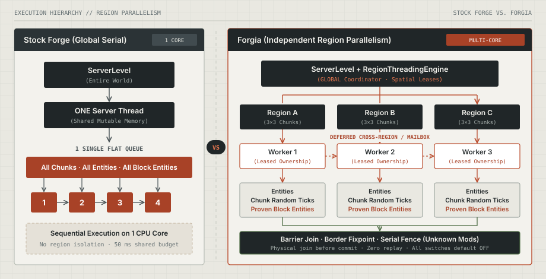

  

    
 NexForge Labs / NeoForge 1.21.1

    <h1>More cores for <em>modded worlds.</em></h1>
    
Forgia is a regionized server runtime for NeoForge. It partitions loaded worlds into dynamically merged regions and moves eligible entity, block-entity and world work onto worker threads—while enforcing ownership boundaries and falling back to the server thread when compatibility cannot be proven.

    

      <a class="action-primary" href="architecture.en/">How Forgia works ↗</a>
      <a class="action-secondary" href="benchmarks.en/">C7 production results ↗</a>
      <a class="action-secondary" href="index.zh/">中文首页 ↗</a>
    

    
 C7 production validation completed · NeoForge 1.21.1

  

  <figure class="hero-visual">
    
Forgia / Regionized RuntimeArchitecture / 01

    
    <figcaption class="visual-caption">Dynamic loaded-island regionsExplicit ownership · Fail-closed compatibility</figcaption>
  </figure>

  
Target<strong>NeoForge <b>1.21.1</b></strong>

  
Production pack<strong><b>188</b> enabled mods</strong>

  
Multiplayer soak<strong><b>20 TPS</b> · 80 min</strong>

  
Exploration test<strong><b>179</b> active regions</strong>

<section class="arch-section-home">
  

    

      
01 — What Forgia is

      <h2>Regionized execution, <em>not just more threads.</em></h2>
    

    
Minecraft worlds contain shared state and decades of single-thread assumptions in mod callbacks. Forgia makes ownership explicit, schedules independent regions concurrently, and keeps unsafe or unverified work on the server thread.

  

  

    

      
<h3>Stock NeoForge</h3>SEQUENTIAL TICK

      

        
Most world simulation competes for the server thread's 50 ms tick budget.

        <ul class="compare-steps">
          <li>WORLDEntities, block entities and many world updates execute in a sequential tick flow.</li>
          <li>MODSMods commonly rely on implicit server-thread access to shared world state.</li>
          <li>SCALINGDispersed player bases and entity-heavy areas can contend for the same core.</li>
        </ul>
      

    

    

      
<h3>Forgia</h3>GLOBAL ↔ REGION

      

        
Independent regions run eligible work on a worker pool under explicit ownership leases.

        <ul class="compare-steps">
          <li>TOPOLOGY<code>DYNAMIC_CLUSTER</code> merges and splits loaded sections into connected region islands.</li>
          <li>SANDBOXOrdinary modded block entities can use the generic Region Sandbox without a per-mod adapter.</li>
          <li>SAFETYUnknown or incompatible callbacks fail closed to a serial path; work is not blindly replayed.</li>
        </ul>
      

    

  

  <a class="text-link" href="architecture.en/">Read the architecture and safety model ↗</a>
</section>

<section class="perf-section">
  

    

      
02 — Latest production validation

      <h2>Tested against a <em>real 188-mod pack.</em></h2>
    

    
C7 validation used the SkyExplorer production pack with Create, Cataclysm, Sable, TacZ and other major mods. These are workload-specific observations, not a universal speedup guarantee.

  

  

    

      
<h3>Multiplayer load</h3>20.0 TPS

      
44–86 active regions · 267–825 chunks · 80-minute soak

      
<strong>18.2–28.4 ms MSPT</strong>

      
No crashes during the recorded 80-minute validation window.

    

    

      
<h3>Active exploration</h3>20.0 TPS

      
179 active regions · 530 chunks

      
<strong>18.8 ms average MSPT</strong>

      
One-minute maximum 87.2 ms; process CPU reached 407% (~4 logical cores busy).

    

    

      
<h3>Block-entity execution</h3>72–82%

      
Share of measured BE execution performed on workers in the C7 workload.

      
<strong>2–3 BE types auto-demoted</strong>

      
This is worker execution share, not a claim that 72–82% of all mod types are compatible.

    

    

      
<h3>Serial fence cost</h3>−91%

      
C7 comparison against the earlier measured state.

      
<strong>4,116 ms → 360 ms</strong>

      
Fence count fell from 911,115 to 18,446 in the reported comparison.

    

  

  <a class="text-link" href="benchmarks.en/">Read benchmark conditions, caveats and historical results ↗</a>
</section>

<section class="architecture-section">
  

    

03 — Core systems
<h2>Concurrency with <em>ownership boundaries.</em></h2>

  

  

    <article class="focus-item">A / 01<h3>Dynamic Cluster</h3>
Loaded sections dynamically merge into connected regions and split after a delay when the topology changes. This is the default region policy.
</article>
    <article class="focus-item">A / 02<h3>Generic Region Sandbox</h3>
Ordinary third-party block entities do not need individual adapters. Boundary violations and unsafe behavior are isolated and can be demoted to serial execution.
</article>
    <article class="focus-item">A / 03<h3>Independent Region Clock</h3>
Regions can schedule their own work without requiring every region to finish at one global tick barrier. Global world state still uses coordinated boundaries.
</article>
    <article class="focus-item">A / 04<h3>Dedicated Compatibility</h3>
Complex mods with global graphs or cross-region invariants—such as Create—can use dedicated compatibility adapters. Most ordinary mods do not need one.
</article>
  

</section>

<section class="status-section">
  
04 — Project status

  

    
<h2>Production-tested. <em>Still evolving.</em></h2>
C7 production validation is complete for the documented 188-mod workload. Forgia is not yet presented as a universal drop-in replacement for every modpack.

    

      
PlatformNeoForge 1.21.1; this documentation describes the current 1.21.1 development line.

      
Region policy<code>DYNAMIC_CLUSTER</code> is the default. Legacy layouts remain for compatibility and specific tests.

      
Mod compatibilityGeneric Sandbox for ordinary BEs; dedicated adapters or serial fences for complex/shared-state behavior.

      
ReleaseForgia 1.21.1 stable release is a future milestone; C20 is the current planned release target.

      <a class="text-link" href="status.en/">Read engineering status and historical evidence ↗</a>
    

  

</section>

<section class="docs-section">
  
05 — Documentation

  
<h2>Explore the <em>project.</em></h2>English &amp; Chinese references

  

    <a href="architecture.en/">01<strong>Architecture</strong><small>Region topology, execution phases, ownership and safety model</small>↗</a>
    <a href="benchmarks.en/">02<strong>Performance benchmarks</strong><small>C7 production workload, controlled tests and historical measurements</small>↗</a>
    <a href="configuration.en/">03<strong>Configuration &amp; tuning</strong><small>Runtime switches, region workers and hardware profiles</small>↗</a>
    <a href="api/README.en/">04<strong>Parallel API &amp; adapters</strong><small>Contracts for mod developers and dedicated compatibility layers</small>↗</a>
    <a href="index.zh/">中<strong>中文文档</strong><small>项目介绍、架构、性能、配置与工程状态</small>↗</a>
  

</section>

Open engineering · NexForge Labs<a href="https://github.com/NexForgeLabs/Forgia">Follow development on GitHub ↗</a>

Forgia is experimental software. Back up worlds and configurations before testing. Compatibility and performance depend on the exact build, modpack, configuration and workload. Parallel execution switches remain opt-in unless explicitly documented otherwise.

