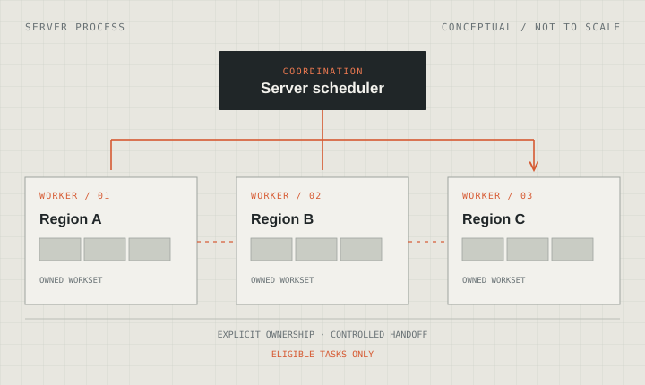

  

    
 NEXFORGELABS / SERVER ENGINEERING

    <h1>More room to <em>run</em>.</h1>
    
Forgia is an experimental regionized server core for NeoForge 1.21.1 — bringing region ownership and parallel execution research to heavily modded Minecraft.

    

      <a class="action-primary" href="README.en/">Explore the project ↗</a>
      <a class="action-secondary" href="https://github.com/NexForgeLabs/Forgia">View source ↗</a>
    

    
 ACTIVE DEVELOPMENT · EXPERIMENTAL SOFTWARE

  

  

    
EXECUTION MODELFIG. 01 — CONCEPT

    
    
01 / REGION OWNERSHIPCOORDINATED, NOT SHARED

  

  
TARGET PLATFORM<strong>NeoForge <b>1.21.1</b></strong>

  
CORE MODEL<strong>Regionized <b>execution</b></strong>

  
PROJECT PHASE<strong>Active <b>research</b></strong>

  
MAINTAINED BY<strong>NexForge <b>Labs</b></strong>

<section class="intro-section">
  
01 — THE IDEA

  

    <h2>Concurrency needs a <em>clear owner.</em></h2>
    
Traditional server ticking is built around a central thread. Forgia explores a different boundary: divide the world into independently owned regions, then move eligible work onto workers without pretending that every interaction is isolated.

    
The hard part is not creating more threads. It is defining who may touch what, when ownership changes, and how cross-region work remains correct.

  

</section>

<section class="architecture-section">
  

    
02 — ENGINEERING FOCUS

    <h2>Built around <em>ownership.</em></h2>
  

  

    <article class="focus-item">
      A / 01
      <h3>Region scheduling</h3>
      
Partition world work into region-owned execution domains, with explicit scheduling and handoff boundaries.

      
    </article>
    <article class="focus-item">
      A / 02
      <h3>Block entity safety</h3>
      
Define admission, ownership and coordination contracts before allowing modded block-entity work off-thread.

      
    </article>
    <article class="focus-item">
      A / 03
      <h3>Mod compatibility</h3>
      
Keep NeoForge and real mod workloads central to the design. Unknown or unsafe paths must fail closed.

      
    </article>
  

</section>

<section class="status-section">
  
03 — HONEST STATUS

  

    

      <h2>Experimental by <em>design.</em></h2>
      
Forgia is under active development. It is not a drop-in, production-ready Folia replacement, and parallel execution is not universally safe for arbitrary mods.

    

    

      
IMPLEMENTED FOUNDATIONRegion-threading infrastructure and selected worker execution paths.

      
ONGOING WORKBroader ownership coverage, cross-region coordination and scheduler evolution.

      
KNOWN LIMITSSome player, mod callback and world interaction paths remain serialized or constrained.

      
NOT A PROMISENo universal mod compatibility or fixed player-capacity guarantee.

      <a class="text-link" href="README.en/">Read implementation status and limitations ↗</a>
    

  

</section>

<section class="docs-section">
  
04 — DEVELOPER RESOURCES

  
<h2>Go <em>deeper.</em></h2>Maintained documentation · English / 中文

  

    <a href="api/README.en/">01<strong>Parallel API</strong><small>Public contracts, capabilities and scheduling</small>↗</a>
    <a href="adapters/README.en/">02<strong>Mod adapters</strong><small>Integration guides and adapter trust model</small>↗</a>
    <a href="modules/README.en/">03<strong>Engine internals</strong><small>Subsystem architecture and implementation notes</small>↗</a>
    <a href="README.zh/">中<strong>中文文档</strong><small>项目说明、API 与模块文档</small>↗</a>
  

</section>

  OPEN ENGINEERING
  <a href="https://github.com/NexForgeLabs/Forgia">Follow development on GitHub ↗</a>

Forgia is experimental software. Back up worlds and configurations before testing. Compatibility and performance depend on the exact modpack, configuration and workload.

