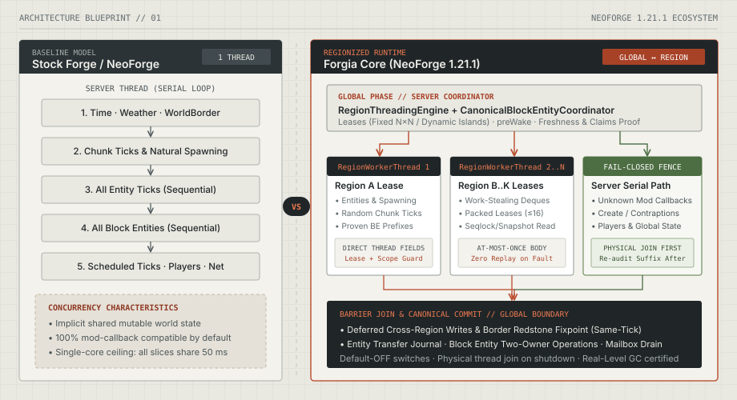
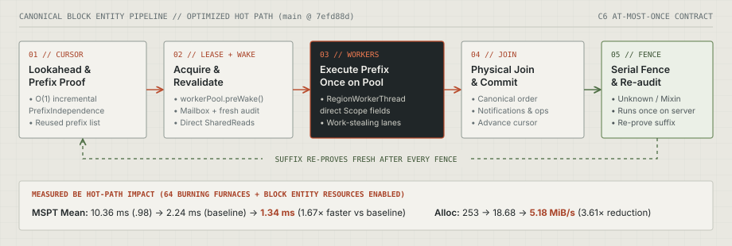

  

    
 NexForge Labs / NeoForge 1.21.1 Runtime

    <h1>Regionized execution for <em>modded worlds.</em></h1>
    
Forgia transforms Stock Forge/NeoForge's single-thread server loop into alternating <code>GLOBAL</code> and <code>REGION</code> execution phases—combining explicit spatial leases, worker-pool parallelism, and fail-closed Serial Fences for unverified mod callbacks.

    

      <a class="action-primary" href="architecture.en/">Architecture vs. Stock ↗</a>
      <a class="action-secondary" href="benchmarks.en/">Performance Data ↗</a>
      <a class="action-secondary" href="architecture.zh/">中文对比 ↗</a>
    

    
 C6 Certified Scope (Fixed Layout) · Default-OFF Experimental Switches

  

  <figure class="hero-visual">
    
Stock NeoForge vs. ForgiaArchitecture Blueprint / 01

    
    <figcaption class="visual-caption">Single Server Thread → Explicit Region LeasesFail-closed Serial Fence preserved</figcaption>
  </figure>

  
Baseline Target<strong>NeoForge <b>1.21.1</b></strong>

  
Entity Parallelism<strong>Up to <b>4.5×</b> (1024 cows)</strong>

  
32-Player Scale<strong><b>3.97 ms</b> (-6.4% vs serial)</strong>

  
BE Hot-Path (64 Furnaces)<strong><b>1.67×</b> MSPT · <b>-72%</b> alloc</strong>

<section class="arch-section-home">
  

    

      
01 — Architecture Comparison

      <h2>Single thread vs. <em>explicit ownership.</em></h2>
    

    
Stock Forge runs every tick slice on one server thread inside implicit shared memory. Forgia keeps vanilla causality while partitioning eligible work across leased worker regions.

  

  

    

      

        <h3>Stock Forge / NeoForge</h3>
        1 SERVER THREAD
      

      

        
All world simulation—chunks, entities, block entities, redstone and players—competes inside a single sequential 50 ms loop.

        <ul class="compare-steps">
          <li>EXECUTIONSequential <code>ServerLevel.tick</code> on one core; async futures limited to chunk IO/gen.</li>
          <li>OWNERSHIPImplicit global thread affinity; mods freely mutate neighbors or shared registries.</li>
          <li>BLOCK ENT.Flat <code>Level.tickBlockEntities</code> loop serializes every furnace, hopper and machine.</li>
          <li>SCALINGHigh entity counts or spread-out multiplayer bases saturate a single CPU core.</li>
        </ul>
      

    

    

      

        <h3>Forgia Regionized Core</h3>
        GLOBAL ↔ REGION
      

      

        
Alternates quiescent <code>GLOBAL</code> coordination boundaries with parallel <code>REGION</code> worker batches—never assuming arbitrary mod code is thread-safe.

        <ul class="compare-steps">
          <li>EXECUTION<code>RegionWorkerThread</code> pool runs leased regions in parallel using direct thread fields &amp; <code>preWake</code>.</li>
          <li>OWNERSHIP<code>RegionState</code> spatial leases + <code>BlockEntityResourceOwnership</code> READ/WRITE scopes.</li>
          <li>BLOCK ENT.<code>CanonicalBlockEntityCoordinator</code> dispatches proven prefixes; unknown mods hit a Serial Fence.</li>
          <li>SAFETYAll switches default to <code>false</code>; at-most-once execution (no replay) and physical join on unload.</li>
        </ul>
      

    

  

  <figure class="diagram-frame">
    
    <figcaption class="diagram-caption">
      EXECUTION HIERARCHY // INDEPENDENT REGION PARALLELISM
      PER-REGION LEASE · MULTI-CORE WORKERS · BARRIER JOIN
    </figcaption>
  </figure>
  <a class="text-link" href="architecture.en/">Explore full Stock vs. Forgia architecture &amp; subsystem matrix ↗</a>
</section>

<section class="architecture-section">
  

    
02 — Core Design

    <h2>Make concurrency <em>explicit.</em></h2>
  

  <figure class="diagram-frame">
    
    <figcaption class="diagram-caption">
      CANONICAL BLOCK ENTITY HOT PATH (main @ 7efd88d)
      O(1) PREFIX PROOF · ZERO-THREADLOCAL WORKER SCOPES · FULL SERIAL FENCE
    </figcaption>
  </figure>
  

    <article class="focus-item">
      A / 01
      <h3>Region Leases &amp; Workers</h3>
      
Partition worlds into <code>FIXED_3X3</code> (3..32 chunk) grids or experimental loaded islands, backed by Fixed or Persistent work-stealing <code>RegionWorkerThread</code>s.

      
    </article>
    <article class="focus-item">
      A / 02
      <h3>Canonical BE &amp; Resources</h3>
      
Preserve vanilla ticker order with a monotonic cursor, O(1) incremental prefix independence, sparse-cleared <code>ResourceTable</code>, and nonblocking wave leases.

      
    </article>
    <article class="focus-item">
      A / 03
      <h3>Fail-Closed Compatibility</h3>
      
Unknown mod callbacks, Mixin-transformed methods, or Create contraptions never run speculatively off-thread—they physically join workers and run once on the server.

      
    </article>
  

</section>

<section class="perf-section">
  

    

      
03 — Measured Performance

      <h2>Where workers win, <em>and where serial stays faster.</em></h2>
    

    
Every measurement below verifies full state or NBT equivalence. Forgia accelerates entity-heavy and multi-player workloads while candidly documenting coordination overhead on tiny stationary BEs.

  

  

    

      

        <h3>1024 Entities (Cows / Villagers)</h3>
        2.1× – 4.5× faster
      

      
4-core/8-thread, JDK 21, ZGC, fixed 3×3 regions, 4 workers (lower MSPT is better).

      

        
1024 Cows Off

27.3 mspt

        
1024 Cows On

6.0 mspt

        
1024 Villagers Off

54.5 mspt

        
1024 Villagers On

25.7 mspt

      

      
1024 Zombies: 22.8 → 6.6 mspt (3.4×). 289 chunks spawning: 4.13–4.62 → 2.79–3.93 ms (1.15–1.65×).

    

    

      

        <h3>32 Real TCP Players (n32-spread)</h3>
        14.7× vs .154 · -6.4% vs Serial
      

      
32 connected players spread across regions, persistent workers, 10s warmup + 30s measured.

      

        
.154 Persistent On

58.30 ms

        
.221 Serial (Off)

4.24 ms

        
.221 2 Workers On

4.22 ms

        
.221 4 Workers On

3.97 ms

      

      
Two-phase dispatch cost dropped 2.450 → 0.918 ms/tick; ping p99 improved 314.11 → 6.35 ms.

    

    

      

        <h3>64 Burning Furnaces (Resources ON)</h3>
        1.67× MSPT · -72% Alloc
      

      
400 warmup + 2×400 ticks, 4 workers, 2 GiB G1. Exact before/after NBT &amp; item conservation verified.

      

        
.98 Before Reuse

10.36 ms

        
Pre-7efd88d Base

2.24 ms

        
Forgia 7efd88d Opt

1.34 ms

        
Forgia Serial / Stock

0.35 / 0.22 ms

      

      
Alloc dropped 253 → 18.68 → 5.18 MiB/s (3.61× reduction). Light stationary BEs remain faster in serial.

    

    

      

        <h3>6000-Tick Mixed Production Soak</h3>
        0.976× mean vs Off
      

      
Generated terrain: villagers, mobs, hopper/furnace lines, farm, border redstone clock &amp; fake player.

      

        
Pre-deferral On

7.35–8.28 ms

        
Same-build Off

6.25–6.70 ms

        
Deferred + Lift On

6.13–6.72 ms

        
Persistent + Packed

6.69 ms

      

      
0 ownership violations, 6200/6200 redstone consistency, 100% dispatched chunks on workers.

    

  

  <a class="text-link" href="benchmarks.en/">View complete benchmark tables &amp; methodology ↗</a>
</section>

<section class="status-section">
  
04 — Status &amp; Boundaries

  

    

      <h2>Research in <em>progress.</em></h2>
      
Forgia is active systems research—not a drop-in Folia clone and not a promise that arbitrary modpacks parallelize automatically.

    

    

      
C6 Acceptance170/170 required GameTests pass on both Persistent and Fixed profiles (10 skipped benchmark/soak tests excluded).

      
Lifecycle &amp; GCStopped-server real-Level GC certified (28/28 references cleared); runtime mod hot-unload remains unsupported.

      
Serial BoundariesPlayers, structures/pistons, Create contraptions and unverified mod callbacks stay on the server thread.

      
Production DefaultsAll 16+ region-threading and resource switches default to <code>false</code>; enable explicitly per workload.

      <a class="text-link" href="status.en/">Read detailed engineering status &amp; receipts ↗</a>
    

  

</section>

<section class="docs-section">
  
05 — Documentation

  
<h2>Explore the <em>codebase.</em></h2>Bilingual English &amp; Chinese reference

  

    <a href="architecture.en/">01<strong>Architecture: Stock vs. Forgia</strong><small>Execution model, phase alternation, canonical BE pipeline &amp; safety invariants</small>↗</a>
    <a href="benchmarks.en/">02<strong>Performance Benchmarks</strong><small>1024 entities, 32-player scale, 64-furnace BE hot-path &amp; 6000-tick soak data</small>↗</a>
    <a href="api/README.en/">03<strong>Parallel API &amp; Mod Adapters</strong><small>Public contracts, audited block-entity execution, Create &amp; MSC adapters</small>↗</a>
    <a href="modules/README.en/">04<strong>Engine Internals</strong><small>Region engine, entity storage, chunk border fixpoint &amp; observability</small>↗</a>
    <a href="architecture.zh/">中<strong>中文架构对比与性能报告</strong><small>原版 Forge vs Forgia 架构对比、实测性能图表与完整中文模块文档</small>↗</a>
  

</section>

  Open engineering · NexForge Labs
  <a href="https://github.com/NexForgeLabs/Forgia">Follow development on GitHub ↗</a>

Forgia is experimental software. Back up worlds and configurations before testing. Compatibility and performance depend on the exact modpack, configuration and workload.

Design approach adapted from <a href="https://github.com/heydamir/unslop">Unslop</a> by Damir Sokolovsky · CC BY 4.0

