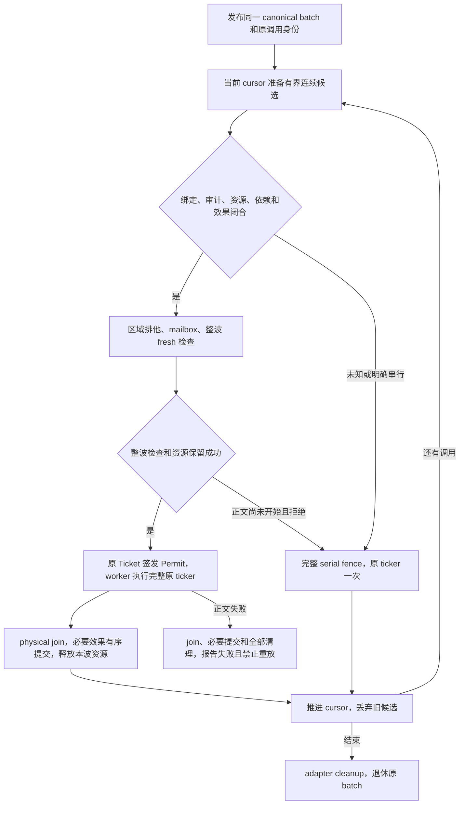

# 统一方块实体并行 Adapter API 设计草案

状态：**设计提案，部分已落地。** 本文描述原版和模组方块实体共用的执行协议。当前实现范围见下一段；后文泛型接口和 resolver 示例仍是设计草图。

当前实现进度：首版已采用继承 audited 合同的 `BlockEntityExecutionAdapter`，接入区域/资源 Scope、依赖版本重审、阶段清理和有界窗口；Create 0.3.0 已迁移。实际签名与限制以[使用文档](../docs/api/block-entity-execution.zh.md)为准。下文泛型上下文、opaque resolver 和通用效果 profile 仍是后续设计，不能当作已实现 API。

## 1. 目标与责任边界

开发者应能发布一个独立 adapter 模组，声明某些方块实体的完整原始 tick 在哪些状态下可以并行、实际访问哪些存储、依赖哪些版本，以及会产生哪些效果。Forgia 负责将声明绑定到真实调用，协调所有权、资源冲突、生命周期和执行时机。

原版类型采用内置 adapter；第三方类型采用外置 adapter。二者最终提交相同的内部候选描述，使用同一 canonical batch、cursor、Ticket、Guard、Permit、worker pool、physical join 和效果提交路径。

这是**显式信任经过审计的 adapter** 的协议。adapter 负责调用闭包、别名和外部写入者的语义完整性；核心负责它能实际核对的调用绑定、存储身份、当前状态和执行约束。资源列表、类哈希、版本号和 `CURRENT` 都不能单独证明任意 Java 程序安全。现有可选 VM/runtime-proof 路径继续独立存在，不能把其窄范围证明宣传为通用 adapter 的自动证明能力。

首批交付目标：

- 保留完整原始 ticker，开发者无需实现调度器或复制业务 tick。
- 同一套接口覆盖区域所有者执行和单区域内的资源细分执行。
- 对未知分支明确返回串行原因；在正文开始前作出选择。
- 大阶段可以分窗口规划，保持原有顺序边界和整阶段预算。
- 一个与 Create 无关的外置示例通过公开 API 获得真实 worker 执行。

## 2. 当前基础与必须补齐的位置

| 本地实现 | 可复用内容 | 需要改变的部分 |
|---|---|---|
| [ParallelAdapterRuntime](../src/main/java/net/neoforged/neoforge/server/threading/ParallelAdapterRuntime.java) | 每服务器事务注册、冻结、重复检查、关闭和诊断 | 增加显式的新执行协议，统一新旧接口的 id/type 冲突检查 |
| [AuditedBlockEntityTickAdapter](../src/main/java/net/neoforged/neoforge/server/threading/api/AuditedBlockEntityTickAdapter.java) | 完整原 tick 审计、实现清单、当前资源足迹 | 新协议承接其语义；增加结构化拒绝、依赖、生命周期和资源细分模式 |
| [BlockEntityAdapterPhase](../src/main/java/net/neoforged/neoforge/server/threading/region/BlockEntityAdapterPhase.java) | 真实 source 绑定、原阶段生命周期、注册有效性检查 | 旧 C5 路径保留；新增候选准备必须发生在未开始 Ticket 上，不能从已开始的 serial Permit 升级 |
| [CanonicalBlockEntityCoordinator](../src/main/java/net/neoforged/neoforge/server/threading/region/CanonicalBlockEntityCoordinator.java) | 唯一单调 cursor、连续 prefix、完整 serial fence | 将整阶段 2048 项串行门槛改为有界规划窗口 |
| [BlockEntityExecutionEngine](../src/main/java/net/neoforged/neoforge/server/threading/region/BlockEntityExecutionEngine.java) | Ticket generation、线程绑定 Permit、owner/subordinate Guard、禁止重放 | 接受核心创建的通用 execution evidence；目前 `MOD_CLAIMS` 仍绑定具体 `CoreModPreparation.Manifest` |
| [BlockEntityResourceOwnership](../src/main/java/net/neoforged/neoforge/server/threading/region/BlockEntityResourceOwnership.java) | 引用身份、READ/WRITE、attachment、预算、reservation、Lease/Scope | 为已审计 resolver 的输出增加核心验证与转换入口，公开层不暴露 Claims/Lease 构造权 |
| [CoreModWorkScope](../src/main/java/net/neoforged/neoforge/server/threading/region/CoreModWorkScope.java)、[FurnaceWorkScope](../src/main/java/net/neoforged/neoforge/server/threading/region/FurnaceWorkScope.java) | 原始 wrapper 上下文、资源 scope 和受审计效果边界 | 抽取共用 wrapper 上下文桥；不能直接放开所有 `ADAPTER_GUARDED` 细粒度执行 |

## 3. 公开协议：新增执行能力，保留旧协议语义

建议新增 `BLOCK_ENTITY_EXECUTION_ADAPTERS` 能力及 `api.execution` 包。现有 `api.adapter` 保持其 Java-only、保守 C5 协议；旧注册方法、record 构造器和 serial-only 行为不变。

新能力仍通过 `RegisterParallelAdaptersEvent` 和 `ParallelApi.Registrar` 注册。`ParallelApi` major 保持 1，新协议有自己的版本号。`Registrar` 新方法使用保守 default，旧核心不支持时由能力检查避开。支持协议不意味着管理员已启用 worker。

建议接口形状如下。以下是签名草图，配套类型尚待实现：

```java
interface BlockEntityExecutionAdapter<B extends BlockEntity, P> {
    Descriptor<B> descriptor();

    AuditManifest audit();

    P prepare(PreparationContext context);

    Inspection inspect(InspectionContext<B, P> context);

    default Inspection refresh(RefreshContext<B, P> context) {
        return inspect(context); // RefreshContext 继承 InspectionContext
    }

    default void phaseClosed(PhaseSummary summary) {}
}

sealed interface Inspection {
    record Serial(Reason reason) implements Inspection {}
    record Candidate(Mode mode, ResourceSet resources,
                     DependencySet dependencies,
                     EffectProfile effects) implements Inspection {}
}

// 在新包中单独定义；不改变旧 BlockEntityAdapters.Request 的构造器。
enum Mode { REGION_OWNER, RESOURCE_SCOPED }
```

### 回调时机

| 回调 | 时机与限制 |
|---|---|
| `descriptor` / `audit` | 服务器注册事务内冻结；回调重入失败不能被吞掉后继续发布 |
| `prepare` | 静止的协调线程，在本轮连续候选规划首次使用该 adapter 时惰性执行；返回脱离世界的不可变数据 |
| `inspect` | 已发布 batch 中，前序 join/必要提交完成后，只读借用真实 source/function 及受限准备服务 |
| `refresh` | mailbox 交付后、持有所需外层区域排他时、任何正文开始前；重新形成完整候选，不能只返回 boolean |
| `phaseClosed` | 已开始工作全部 join、必要效果提交后，对本阶段进入过准备或检查的 adapter 调用一次；失败也执行所有 adapter 的清理 |

`prepare` 的数据按规划轮次带 generation。执行 prefix、跨 serial fence 或交付 mailbox 后，旧轮次不能作为新许可直接复用。只读且与这些变化无关的数据可通过明确的不可变数据缓存复用；拓扑成功检查不能以“同一 gameTime”为理由复用。

所有上述回调均在协调线程运行，且调用第三方代码时不持有核心内部 monitor。worker 上只保留核心的轻量绑定/lease 检查，之后执行原 ticker；第一版不引入任意 worker 端 validator 回调。

`P` 只服务 adapter 的准备和检查。它不会自动替换原 ticker 的世界读取。若正文仍读取 live 配方管理器、网络或 provider，adapter 必须独立闭合这些访问；生成一份快照并不会自动使原正文安全。

### Descriptor 与借用上下文

Descriptor 包含：adapter id、目标 type id、精确 source/ticker 范围、声明的执行模式、审计 profile 和有界预算需求。预算需求只用于提前拒绝，不允许 adapter 提高核心上限。

上下文只在当前回调和协调线程有效。source 和 ticker 实例为短暂借用，返回后不得保留或作为异步工作输入。核心在每次外部回调后重新验证真实 wrapper/delegate/source/function、位置、BlockState、chunk membership、注册身份和生命周期。Java view 是开发合同，不是语言级只读沙箱。

有状态 ticker 需要上下文提供实际绑定的函数实例，并将捕获字段到达的存储纳入资源集合；不能只开放 `Class<?>` 然后取消现有字段拒绝。首个实现可以继续仅支持无状态 ticker，以独立能力及测试扩大覆盖。

## 4. 资源与依赖：开发者声明，核心绑定和保留

### 4.1 资源句柄与 resolver

Candidate 中仅放核心创建、具有服务器/阶段/轮次身份的不透明 `ResourceRef`，没有 public constructor；句柄不向 worker 发放 Level、chunk 或 Lease。

上下文自动加入 source 的 WRITE。标量字段可以随 source 归属处理；库存、ItemStack、组件集合、behaviour、controller、ticker 实例和静态共享缓存等独立可变存储仍须完整列出。

开发者可随 adapter 注册经过审计的资源 resolver。resolver 在协调线程上，从本次真实绑定的 source 或受控 participant 解析：

- 真正 backing root 的引用身份，不能把 sided handler、代理对象或 wrapper 的身份直接当作底层库存身份。
- 当前 attachment 和生命周期，以及能够受控的所有写入路径。
- 访问模式及所需的其他可变根，例如容器中的可变 ItemStack 和共享组件。

resolver 本身属于该 adapter 的审计清单。核心推导实际 home、核对调用范围、保存 attachment 检查并形成内部 Claims。`resolve` 调用成功只是得到待核对的描述；开发者不能传任意 `home`、自建 Lease 或返回 `true` 直接获得所有权。

第一版只接受实例本地和同一 home 中已闭合的资源，以及有明确发布合同的共享 READ。共享可变 controller、多 home 和未知外部写入者先完整串行。跨区域同 root 必须识别为别名并拒绝不支持的归属，不能按位置造出两个互不冲突的身份。

### 4.2 Capability 与失效

Capability 查询可能调用 provider；本地 [BlockCapabilityCache](../src/main/java/net/neoforged/neoforge/capabilities/BlockCapabilityCache.java) 的 cache miss 仍会进入 `level.getCapability`，缓存失效由相关通知驱动。

因此 provider 查询不能成为 worker 的自动资源发现步骤。已审计 resolver 可在允许的协调线程窗口解析已有连接；必须处理 replacement、卸载、capability invalidation、controller 切换和 wrapper 到 backing root 的映射。未知 provider/映射返回结构化串行原因。缓存有效也不证明底层库存内容没有被写入。

### 4.3 依赖也参与冲突

核心管理的依赖句柄记录拓扑、配方 reload、配置和 capability attachment 等版本。adapter 在候选中声明依赖，相关写入路径必须使它失效；核心不能自动发现模组遗漏的变更通知。

版本检查只能发现已经发生的变化。若同一波的 A 会修改 B 的依赖，A 的 WRITE 与 B 的 READ 还必须通过同一个资源身份形成冲突，不能只在波开始前比较版本。

`refresh` 必须重新形成相同范围的候选。若资源身份、访问模式、依赖版本或效果 profile 改变，先丢弃尚未开始的计划，重新规划或完整串行；不能在已保留的 Lease 上增加资源。重新规划受独立次数/时间预算限制。

## 5. 执行模式和效果

| 模式 | 执行权与适用范围 |
|---|---|
| `REGION_OWNER` | 一个 worker 持有完整区域所有者身份，区域内调用按原序；仍要求完整正文审计，区域所有权不覆盖外部网络或共享全局状态 |
| `RESOURCE_SCOPED` | 协调线程持有外层区域排他，多个 worker 仅持有自己的资源 Scope；相同区域内资源独立的机器可以并行，没有完整区域世界修改权 |
| `Serial(reason)` | 所有前序 worker 已 join 且必要效果已提交后，在服务器线程完整执行原 tick 一次 |

同一 home 的 REGION_OWNER 与 RESOURCE_SCOPED 互斥。不同 home 的混合执行需要统一 planner 验证；首批可按模式拆成不同连续 prefix，避免同时改变全部调度策略。

效果使用核心实现、带版本的有限 profile，分阶段开放：

1. `LOCAL_STATE_ONLY`：只修改已声明资源，无可观察的外部效果。
2. 经审计的 dirty/同步/通知 profile：使用原有核心 hook 捕获指定效果，绑定原 Ticket、ordinal、generation 和 effect index，join 后按合同提交。
3. 后续独立审计的其他 profile。

选择 profile 不是获得任意 `setChanged`、事件或网络调用的许可。必须逐项审计 override、监听器、通知和回调，明确哪些同步执行、哪些允许延迟、哪些保持 level-end 时机。若正文会依赖某效果的同步结果，不能未经协议转换就把它移到末尾。也不能默认合并多次通知不改变语义。

公开接口不提供 `execute(Runnable)`、任意 `commit(Runnable)` 或线程池句柄。未知事件、假玩家、世界查询、跨 home 写入和未闭合 RNG/回调分支，在正文前完整串行。正文开始后发现合同违反属于失败：join、提交必要效果、清理并报告，禁止主线程重放。

## 6. 调度过程与大阶段窗口



第一版采用连续且无冲突的 prefix。遇到资源冲突就结束本波，执行完成后再检查后续调用；无需先引入跨多波缓存的全阶段 DAG。不能为填满 worker 跳过 unknown fence，也不能将后续确定的工作提前到未知调用之前。

现有 2048 项限制改为**单个规划窗口最多 2048 个候选**，不提高现有每单元资源上限及 131072 整阶段逻辑 binding 预算。不同桥可继续使用更小的上限，例如旧 audited footprint 的 64 项。

窗口切换必须满足：

- 沿用同一 batch/cursor、原 canonical ordinal、区域 RNG 流和整阶段预算。
- 前一波全部 join、完成必要提交后，才读取后一窗口的当前状态。
- 整阶段的身份/home/别名记账按受限表保留，不能每个窗口清空后重新发放预算。
- 重复 root 的每个 attachment/validator 和每次逻辑资源声明都计入正确预算；重规划另有限额，不能无限尝试。
- 超过整阶段预算时，尚未开始的后缀完整串行；adapter 清理仍正常执行。

这首先限制活跃计划、proof 和 reservation 的规模。第一阶段可以保留 O(N) 的原成员快照和 Ticket 集合，不能据此宣称整个阶段内存已是 O(window)；懒创建 Ticket/流式成员收集属于后续独立改动。

具体不能只删除 coordinator 的一次 `size > MAX_UNITS` 判断：其 prefix 扩张循环必须显式受窗口限制；`BlockEntityWorkPlanner` 和 `BlockEntityResourceOwnership` 的 2048 输入上限仍用于每个窗口/波；`RegionBlockEntityWorkGraph` 目前只采样最前面的有限候选，需要分别报告整阶段执行总量与有界采样，避免把被省略的诊断条目视为未执行。Furnace 的整阶段 alias 检查及逻辑资源预算也要保留。

## 7. 开发者接入示例

以下仅演示接口使用方式。假设 `LocalCounterBlockEntity` 的审计完整证明：选中分支只修改自身标量字段，不查询世界、不调用其它对象、不读写共享状态。真实 ticker 的 exact binding 和所有到达实现由 `LocalCounterAudit` 固定；`initialized()` 本身也在审计闭包内。

```java
final class CounterAdapter
        implements BlockEntityExecutionAdapter<LocalCounterBlockEntity, NoData> {
    public Descriptor<LocalCounterBlockEntity> descriptor() {
        return LocalCounterAudit.descriptor();
    }

    public AuditManifest audit() {
        return LocalCounterAudit.manifest();
    }

    public NoData prepare(PreparationContext context) {
        return NoData.INSTANCE;
    }

    public Inspection inspect(InspectionContext<LocalCounterBlockEntity, NoData> context) {
        if (!context.source().initialized()) {
            return context.serial(Reason.INITIALIZING);
        }
        return context.candidate(Mode.RESOURCE_SCOPED)
                // source WRITE 由核心自动加入；本示例没有其他可变根。
                .effects(EffectProfile.LOCAL_STATE_ONLY)
                .build();
    }
}

// RegisterParallelAdaptersEvent 内；新协议自身版本为 1。
if (registrar.capabilities().contains(BLOCK_ENTITY_EXECUTION_ADAPTERS)) {
    registrar.registerBlockEntityExecutionAdapter(1, new CounterAdapter());
}
```

兼容模组只需 compileOnly facade，运行时由 Forgia 提供 API。发布物应包含明确的目标版本、审计范围、回退条件和真实原 ticker 验证。框架提供 named ticker、库存 resolver、失效订阅和测试 fixture 模板，减少每个开发者复制内部桥代码。

## 8. 原版、新旧 adapter 的选择与迁移

- 内置 Hopper/Furnace 等适配器先包装现有已证明分支，使用共同内部 evidence 和执行骨架；不在迁移时扩大支持状态，也不把所有原版类型默认视为安全。
- 内置实现作为明确的 fallback provider。每个 type 最多一个外部注册；替换内置实现必须显式声明 `REPLACE_BUILTIN`，禁止通过监听器顺序或优先级竞争。
- 选择在注册冻结时确定；被选择的外部 adapter 返回 Serial 时，完整串行，不能再尝试其它 adapter 提升权限。管理员 server-only、引擎开关和兼容限制始终保留否决权。
- legacy predicate 仍只是拒绝门；旧 C5 请求仍是 serial-only。旧 audited 合同可以内部桥接 REGION_OWNER，但不能自动扩大为 RESOURCE_SCOPED。
- 外部注册沿用既有 128 项总预算及跨协议 id/type 冲突规则。固定数量的内置 fallback 另有明确上限，不偷偷消耗旧外部注册额度。
- 新 API 使用同一 server session 和冻结事务。注销/失效只阻止未开始调用；已经开始的工作必须先真实返回，才退休相关引用和资源。

## 9. 建议实施顺序与完成标准

| 阶段 | 实现内容 | 完成证据 |
|---|---|---|
| P0 共用内部描述 | 抽取不可由公开数据直接构造的 `BoundInvocationEvidence` 协议；封装真实 binding、审计来源、claims、当前性和效果 profile；Hopper/Furnace/旧 audited 保留各自证明生产者 | 现有原 tick、fence、effects、资源、生命周期测试保持通过；未知 C5 和普通白名单无法创建 evidence |
| P1 规划窗口 | 修改 canonical coordinator 的阶段门槛，保持单 cursor、跨窗口身份记账和整阶段预算 | 2048/2049/多窗口真实调用次数、跨窗口 alias、fence、replacement、失败和 shutdown 验证 |
| P2 新公开协议的 REGION_OWNER | 新 capability/注册、借用 context、Serial(reason)、审计/资源 resolver、协调线程 inspect/refresh、phase cleanup；旧 audited 可桥接 | 独立外置示例在真实 Level 路径的两个区域出现原正文重叠；legacy/C5 不自动升级；事务/ABI 测试通过 |
| P3 通用 RESOURCE_SCOPED | 新 evidence 接入 kernel 的资源 Scope；共用 wrapper 上下文桥；起步只开放 LOCAL_STATE_ONLY 和已闭合单 home 资源 | 同区域两台独立示例机器真实重叠；同 root 写冲突、跨 home alias、owner/scope 互斥、越界效果和异常无重放验证 |
| P4 常用资源和效果扩展 | 审计库存/ItemStack/组件 resolver 与 dirty/同步效果；迁移已有 Furnace 证据；增加第一批真实加工机器 | 独立 adapter 与原版混合，验证 output、物品守恒、通知顺序、reload/invalidation、失效后重审 |
| P5 大整合包验收 | 大混合阶段、多玩家、长时生命周期及同存档性能 A/B | 分别报告正确性、实际 worker 完成和全 tick MSPT/CPU/分配；提交量或计数不能代替收益 |

P0–P3 构成第一版可供外部开发者使用的通用执行框架。多 home 组件、流体/能量网络、跨维度操作和纯计算/结果 apply 继续作为单独能力扩展；它们不能通过增加一个 resource 枚举值或一个 `safe=true` 开关获得支持。

P0/P2/P3 的关键 kernel 改动是：在原 Ticket 尚未开始时附加由核心创建的 evidence，区分原版、受信任 adapter 与 VM/runtime-proof 来源。`reinspectUnstarted` 必须退休旧 evidence 和 generation。当前 C5 `AdapterProof.SERIAL_ONLY` 分支保持不可提升；新路径不能先调用 `beginSerial` 再尝试转换成 worker Permit。`RESOURCE_SCOPED` 对 `ADAPTER_GUARDED` 的现有拒绝只能由这条新协议的完整绑定、claims 和 scope 验证替代，不能整体移除该检查。

### 必须覆盖的测试

1. 真实原始函数、Core wrapper、Level 入口与 worker overlap，不能只测试 planner 或换成模拟 tick。
2. 单线程对照的资源结果与允许观察的效果顺序；加入第三方完整 serial fence 后重审后缀。
3. 两个不同 wrapper 共享 root、READ/READ、READ/WRITE、同 home/跨 home 别名，以及依赖被同波写入者改变。
4. 实现指纹变化、未知 Mixin、未知 subclass/function、带捕获状态 ticker、注册失效和同位置 replacement。
5. source/target 卸载、reload、capability invalidation；prepare/inspect/refresh/cleanup 抛异常时释放全部资源。
6. 正文或效果部分生效后抛异常：实际调用一次、必要 join/提交完成、未开始后缀不执行、下一阶段可恢复。
7. 2048/2049、跨多窗口预算不重置、重规划上限、executor rejection、persistent pool、owner/scope 互斥及 unload/shutdown 等待真实完成。
8. 外置示例仅依赖 facade；核心 kernel/planner 不依赖具体模组；旧协议 ABI 和 serial-only 语义保持。

### 开发诊断

每个 adapter/profile 至少提供：候选数、实际 worker starts/completions、完整串行次数、按固定 reason 的拒绝数、资源冲突拆波数、失效/重规划数、预算拒绝数，以及 prepare/inspect/refresh/body/commit 耗时。全局再报告窗口数、owner/scoped 执行量和整阶段预算使用。

Reason 使用固定枚举或注册冻结时声明的有界标签，不包含坐标、网络 id 或任意用户文本。实现完整性、分支准入、实际成功完成和性能收益分别展示。
